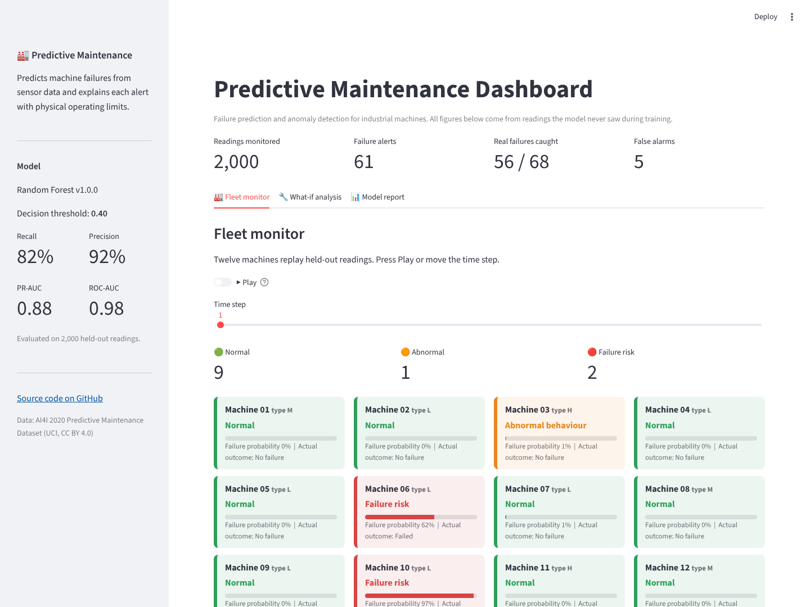
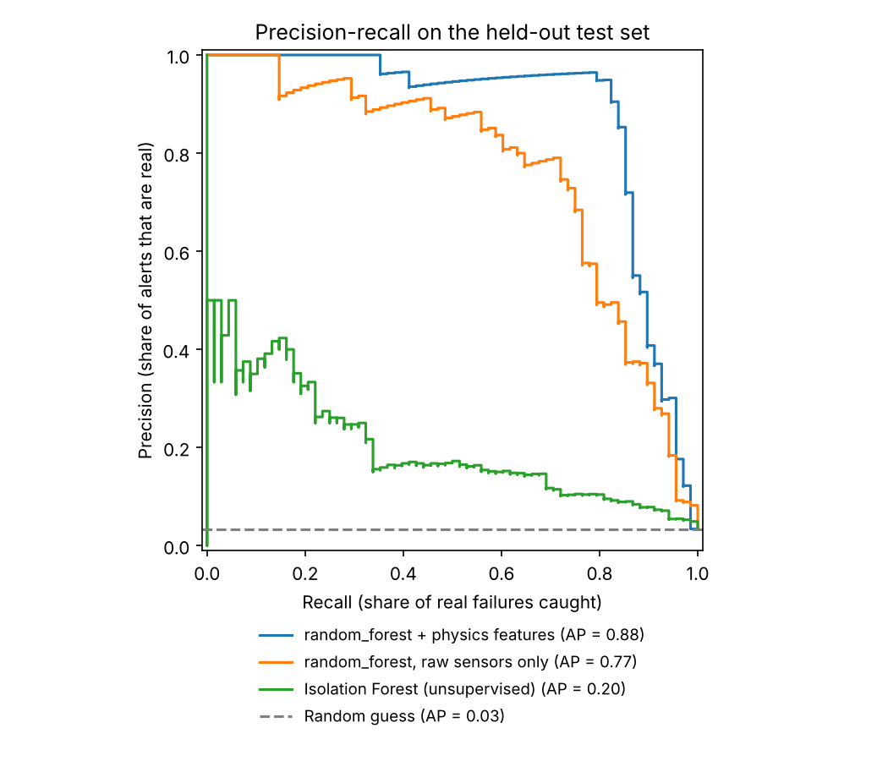
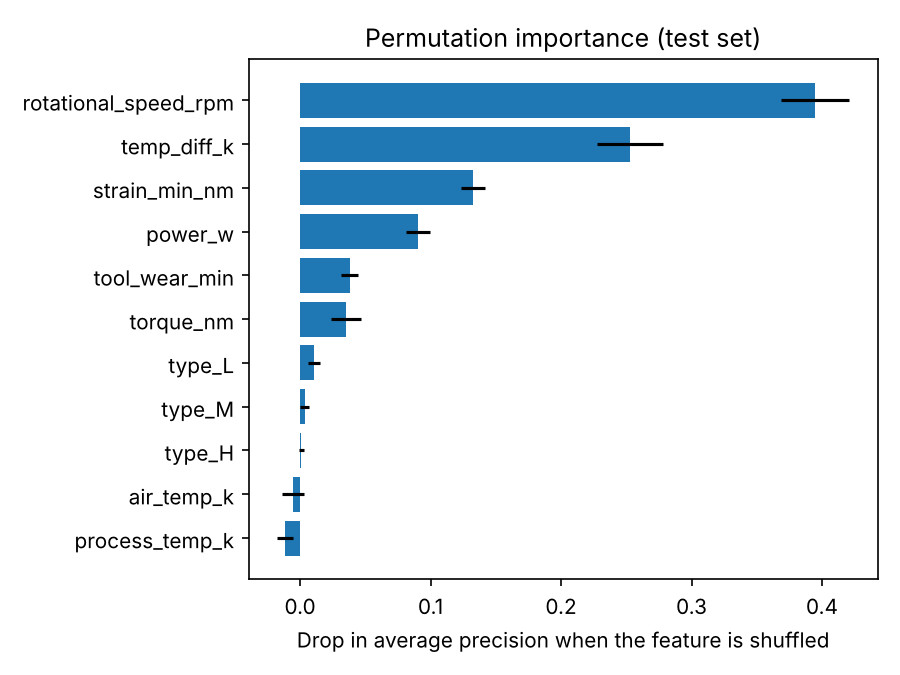
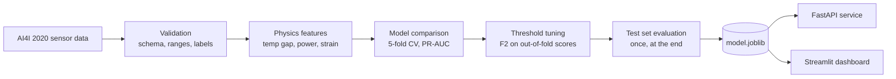
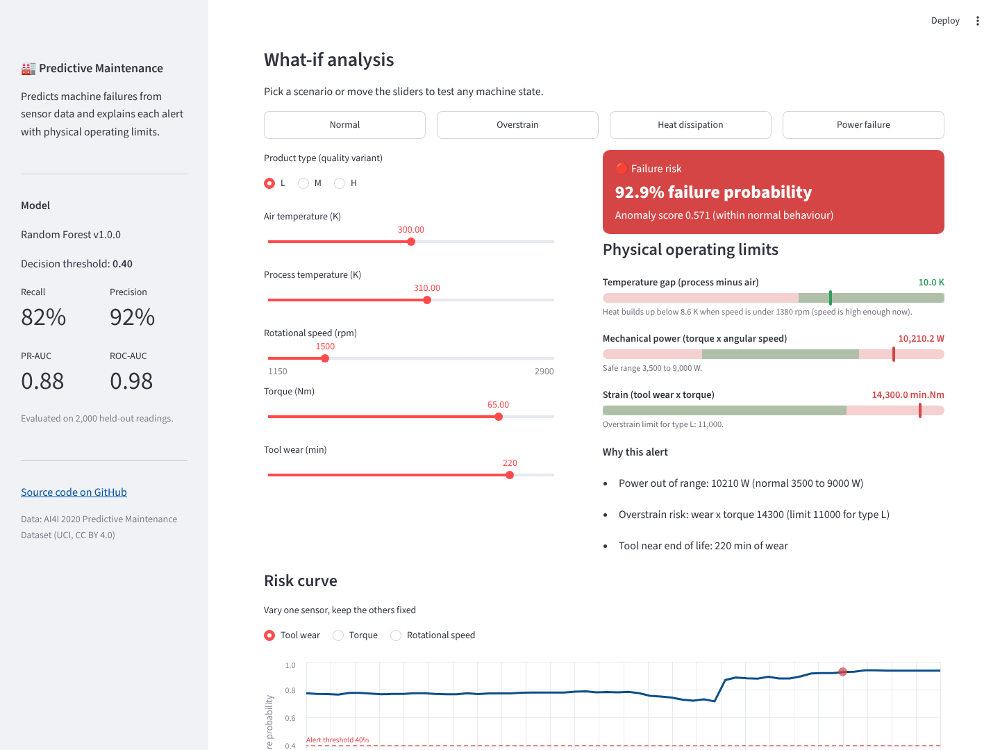

# Predictive Maintenance for Industrial Machines

[](https://github.com/ahmedbmohamed/predictive-maintenance-ml/actions/workflows/ci.yml)


Predicts machine failures from sensor data before they happen, explains each alert in plain words, and flags abnormal behaviour that was never labelled. The project covers the full path from raw data to a tested, containerised service: data validation, physics-based feature engineering, model selection, threshold tuning, a REST API, a monitoring dashboard and a CI pipeline with a model quality gate.



## Results

Evaluated once on a held-out test set of 2,000 readings (68 real failures) that was never used for training, model selection or threshold tuning.

| Metric | Value | Meaning |
|---|---|---|
| Recall | **82.4%** | 56 of 68 real failures caught |
| Precision | **91.8%** | 5 false alarms in 1,932 healthy readings |
| PR-AUC | **0.879** | Random guessing scores 0.034 on this data |
| ROC-AUC | 0.978 | |

**Physics-based features make the biggest difference.** The same Random Forest trained on raw sensor values only reaches a PR-AUC of 0.765 and raises 40 false alarms instead of 5.

| Failure mode | Test cases | Caught |
|---|---|---|
| Overstrain (OSF) | 16 | 100% |
| Heat dissipation (HDF) | 29 | 97% |
| Power (PWF) | 13 | 92% |
| Tool wear (TWF) | 10 | 20% |
| Random (RNF) | 4 | 0% |

The weak modes are expected. In this dataset, tool wear failures happen at a *random* point between 200 and 240 minutes of wear, and random failures have a 0.1% chance on any reading regardless of the sensors. No model can predict them reliably from a single snapshot. This is reported rather than hidden.

<p align="center">
  
  
</p>

## How it works



### Key decisions

**Metric.** Only 3.4% of readings are failures, so accuracy is meaningless (a model that never predicts a failure is 96.6% accurate). Models are compared on PR-AUC, which focuses on the rare class.

**Physics-based features.** The dataset documentation describes how each failure happens. Three features express these mechanisms directly:

| Feature | Formula | Failure it captures |
|---|---|---|
| `temp_diff_k` | process temperature minus air temperature | Heat dissipation |
| `power_w` | torque x rotational speed (rad/s) | Power failure |
| `strain_min_nm` | tool wear x torque | Overstrain |

**No data leakage.** The five failure mode columns (TWF, HDF, PWF, OSF, RNF) describe *why* a machine failed, which is only known afterwards. They are excluded from the inputs, and a test enforces it. They are used only to analyse recall per failure mode.

**Model selection.** Three models were compared with stratified 5-fold cross-validation on the training set:

| Model | CV PR-AUC |
|---|---|
| Logistic regression (baseline) | 0.459 ± 0.042 |
| **Random Forest** | **0.894 ± 0.025** |
| Gradient boosting | 0.887 ± 0.019 |

Class imbalance is handled with class weights instead of oversampling, so no synthetic readings are created.

**Decision threshold.** In maintenance, a missed failure (unplanned downtime) costs much more than a false alarm (one extra inspection). The threshold is tuned to maximise F2, which weights recall twice as much as precision. It is tuned on out-of-fold predictions from the training set, never on the test set.

**Anomaly detection.** An Isolation Forest is trained on healthy machines only and flags readings that look unlike normal operation, capped at a 3% false alarm rate. On its own it catches far fewer failures than the supervised model (PR-AUC 0.20). Its role is different: it can flag a new kind of abnormal behaviour that never appeared in the labelled data, so it complements the classifier instead of replacing it.

**Explanations.** Each alert lists the operating limits the reading is close to or beyond, such as "Overstrain risk: wear x torque 14300 (limit 11000 for type L)". These come from the published limits of the dataset, so an operator gets a reason they can check, not just a probability.

## Project structure

```
src/pdm/
  config.py       paths, columns, training settings
  data.py         loading and validation
  features.py     physics-based feature engineering
  train.py        model comparison, threshold, evaluation, artifacts
  evaluate.py     metrics and figures
  predictor.py    shared inference used by the API and the dashboard
api/main.py       FastAPI service with input validation
dashboard/app.py  Streamlit dashboard
tests/            24 tests: data, features, model quality, API
```

## Run it yourself

With Docker:

```bash
docker compose up --build
# API docs:  http://localhost:8000/docs
# Dashboard: http://localhost:8501
```

Without Docker (Python 3.11 or later):

```bash
pip install -r requirements-dev.txt
pip install -e .
python -m pdm.train          # about one minute, writes models/ and reports/
pytest -q
uvicorn api.main:app         # http://localhost:8000/docs
streamlit run dashboard/app.py
```

Example request:

```bash
curl -X POST http://localhost:8000/predict \
  -H "Content-Type: application/json" \
  -d '{"product_type": "L", "air_temp_k": 300, "process_temp_k": 310,
       "rotational_speed_rpm": 1300, "torque_nm": 65, "tool_wear_min": 220}'
```

```json
{
  "failure_probability": 0.9347,
  "failure_predicted": true,
  "anomaly_score": 0.5846,
  "is_anomaly": false,
  "status": "FAILURE_RISK",
  "reasons": [
    "Overstrain risk: wear x torque 14300 (limit 11000 for type L)",
    "Tool near end of life: 220 min of wear"
  ]
}
```

Invalid input, such as a negative torque or an unknown product type, is rejected with HTTP 422.

## Dashboard

* **Fleet monitor**: twelve machines replay held-out readings, with a Play mode, colored status cards and an alert log sorted by risk.
* **What-if analysis**: one-click scenarios (normal, overstrain, heat dissipation, power failure), gauges showing each physics feature against its operating limit, and a risk curve showing how the failure probability changes when one sensor varies.
* **Model report**: interactive charts for the model comparison, recall by failure mode, permutation importance and the confusion matrix.



## CI pipeline

Every push runs:

1. Lint and format checks (ruff)
2. 24 tests, including a training run on the real data
3. Full training
4. **Model quality gate**: the pipeline fails if recall drops below 75%, precision below 80% or PR-AUC below 0.80, so a change that makes the model worse cannot be merged silently
5. Docker image build and an API smoke test against the running container

## Limitations and next steps

* The data is synthetic (published to reflect real industrial machines) and each reading is an independent snapshot. With real time series, rolling features (trends over the last hours) would improve tool wear prediction.
* Drift monitoring: compare live sensor distributions with the training data and trigger retraining when they diverge.
* Probability calibration and a cost-based threshold, once real costs of downtime and inspection are known.

## Dataset

AI4I 2020 Predictive Maintenance Dataset, S. Matzka, UCI Machine Learning Repository, 2020, [doi:10.24432/C5HS5C](https://doi.org/10.24432/C5HS5C). Licensed under CC BY 4.0. 10,000 readings, 339 failures. The file includes 27 rows where the failure flag and the failure mode labels disagree. They are kept as published and counted in `reports/metrics.json`.

## Author

Ahmed Benmohamed, engineer in security of computer systems and networks (TEK-UP University, 2026).
[LinkedIn](https://www.linkedin.com/in/ahmed-benmohamed-71b243309) · [Portfolio](https://ahmedbmohamed.github.io)
